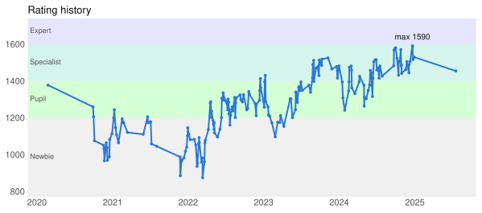
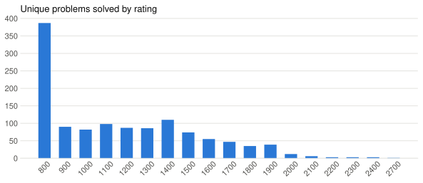
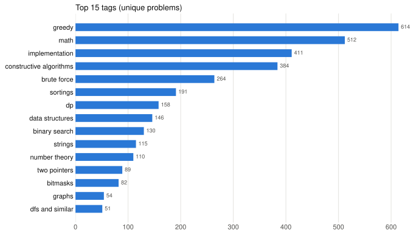

# Codeforces Solutions — aceC0der

   

My accepted solutions on [Codeforces](https://codeforces.com/profile/aceC0der), with statistics generated from the Codeforces API. Last updated **2026-10-16**.

## Profile

| | |
|---|---|
| Handle | [aceC0der](https://codeforces.com/profile/aceC0der) |
| Rating | **1454** (Specialist) |
| Max rating | **1590** (Specialist) |
| Rated contests | 199 |
| Best contest rank | #557 in [Codeforces Round 974 (Div. 3)](https://codeforces.com/contest/2014) |
| Biggest gain / drop | +149 / -142 |
| Unique problems solved | 1218 |
| Accepted submissions | 1269 of 2760 |
| Member since | 2018-10-29 |

## Rating history

<picture>
  <source media="(prefers-color-scheme: dark)" srcset="assets/rating-dark.svg">
  
</picture>

## Solved by difficulty

<picture>
  <source media="(prefers-color-scheme: dark)" srcset="assets/by-rating-dark.svg">
  
</picture>

| Rating | 800 | 900 | 1000 | 1100 | 1200 | 1300 | 1400 | 1500 | 1600 | 1700 | 1800 | 1900 | 2000 | 2100 | 2200 | 2300 | 2400 | 2700 |
|---|---:|---:|---:|---:|---:|---:|---:|---:|---:|---:|---:|---:|---:|---:|---:|---:|---:|---:|
| Solved | 387 | 90 | 82 | 98 | 87 | 86 | 110 | 74 | 55 | 47 | 35 | 39 | 12 | 6 | 3 | 3 | 3 | 1 |

1218 of 1218 solved problems have an official rating.

## Tags

<picture>
  <source media="(prefers-color-scheme: dark)" srcset="assets/tags-dark.svg">
  
</picture>

## Repository layout

```
contest/<contestId>/<Index>_<Name>.<ext>    # solved live in a contest (473 files)
practice/<contestId>/<Index>_<Name>.<ext>   # practice and virtual contests (749 files)
```

- One file per problem per folder: the fastest accepted submission (latest one on a tie).
- A problem solved both in a contest and in practice has a file in each folder.
- Every file starts with a header: problem link, submission link, rating, tags, time/memory, date.
- Gym problems are not included.

The full list of solved problems is in **[PROBLEMS.md](PROBLEMS.md)**.
